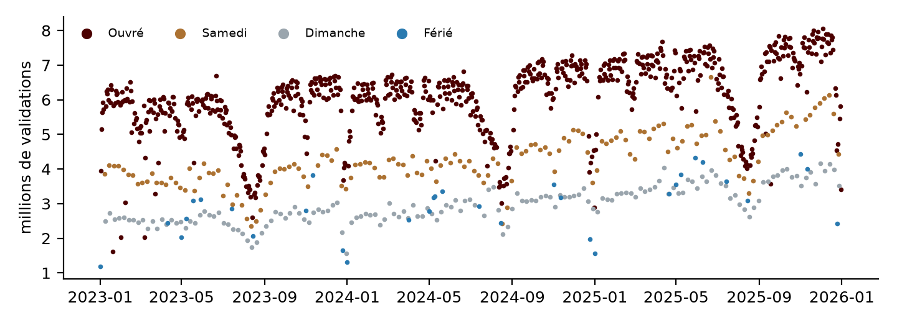
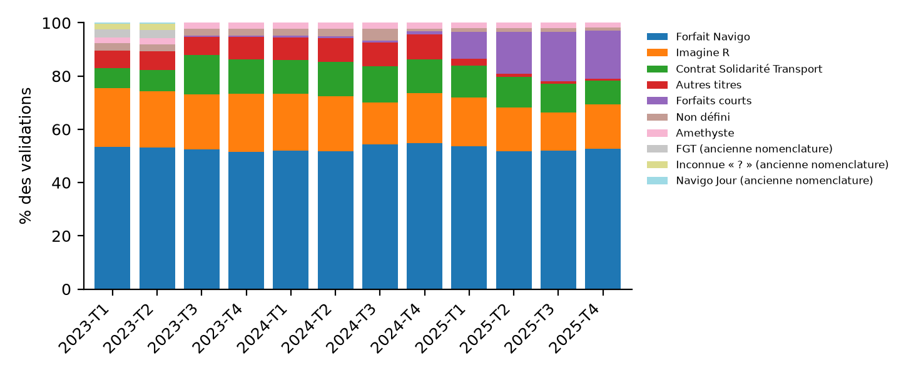

# Sigles et conventions {.unnumbered}

\markboth{SIGLES ET CONVENTIONS}{}

| Terme | Sens dans ce rapport |
|---|---|
| IDFM | Île-de-France Mobilités, producteur des validations et des zones |
| GCS, BQ | Google Cloud Storage, BigQuery |
| ZdC | zone de correspondance : arrêts proches reliés à pied (`ZdCId`) |
| Validation | passage d'un titre en entrée de station ; **ce n'est pas un voyageur unique** |
| Jour d'exploitation | de 04 h 00 à 03 h 59 le lendemain (champ `JOUR`) |
| Snapshot | ensemble figé des fichiers sources collectés sous une même date (`2026-10-31`) |
| Station éligible | station météo dont TM et RR sont exploitables sur au moins 95 % des jours de la période |
| Non précisé | information absente des sources consultées ; elle n'est pas déduite |

: Sigles et conventions {#tbl-sigles}

\newpage

# Introduction {.unnumbered}

\markboth{INTRODUCTION}{}

Le sujet demande de préparer, sur Google Cloud, des données de fréquentation du réseau ferré
francilien utilisables par un Data Scientist, un Data Analyst et un agent IA. Le travail porte sur
la préparation des données : ni modèle, ni tableau de bord, ni agent ne sont développés. Quatre
sources sont imposées [@consigne_td1; @sources_td1] : les validations quotidiennes IDFM, le référentiel des zones de
correspondance, les jours fériés de la zone métropole et la météo quotidienne de Météo-France.

La question directrice est la suivante : **comment livrer, à partir de fichiers publics hétérogènes,
un modèle analytique dont chaque chiffre peut être retracé jusqu'à l'octet source, et qui donne
le même résultat à chaque exécution ?** Le rapport décrit l'architecture (partie 1), les
transformations des quatre sources (partie 2), le modèle Gold (partie 3), les contrôles et leurs
résultats (partie 4), les exemples d'exploitation (partie 5), puis discute les limites, la fiabilité
des tables, l'usage de l'IA et les apprentissages (parties 6 à 8).

Tous les chiffres cités proviennent de l'exécution du pipeline sur le snapshot du 31 octobre 2026
et sont reproduits par le notebook `TD1_ADJAKOSSA_AKODEKOU.ipynb`.

# Architecture et méthode

## Architecture médaillon

```{=latex}
\begin{center}\small
\begin{tabular}{p{2.1cm} p{3.4cm} p{8.8cm}}
\toprule
\textbf{Couche} & \textbf{Support} & \textbf{Rôle et règle principale} \\
\midrule
Bronze & GCS, \texttt{bronze/<source>/ snapshot=<date>/<partition>/} & octets d'origine, jamais modifiés ni écrasés ; manifeste de provenance et SHA-256 par objet \\
Silver & BigQuery \texttt{silver\_idfm} & une table de chargement par source (schéma explicite, remplacement), puis une table finale typée et documentée ; anomalies quantifiées, jamais masquées \\
Gold & BigQuery \texttt{gold\_idfm} & dimensions, faits, variables et vues KPI ; clés de dimension uniques vérifiées avant jointure \\
Contrôles & \texttt{sql/checks/} & une ligne par contrôle : mesure, attendu, statut, interprétation \\
\bottomrule
\end{tabular}
\end{center}
```

Le code est séparé par responsabilité : `src/collect/` (appels HTTP, validation des réponses),
`src/bronze/` (chemins, dépôt, manifestes), `src/silver/` (normalisation et chargement),
`sql/silver/` et `sql/gold/` (transformations versionnées), `src/quality/` et `sql/checks/`
(contrôles et empreintes). Le notebook n'appelle que ces fonctions ; il est le point d'entrée
manuel, sans orchestration. L'exécution est locale (Ubuntu 24.04 sous WSL2) avec les identifiants
par défaut de Google (ADC) ; aucun identifiant de projet n'est écrit dans le code, tout est lu dans
`.env`. Chaque requête BigQuery est plafonnée à 10 Go facturés.

## Choix de stockage

Deux skills Google (`google-cloud-storage-basics`, `bigquery-optimization`) ont servi à auditer la
configuration.

* **Cloud Storage.** Le bucket est en région EU, avec accès uniforme, accès public bloqué et
  suppression réversible pendant 7 jours (*soft delete*). En plus de la précondition de création,
  chaque objet Bronze et son manifeste portent un **hold temporaire** : tant qu'il est posé, GCS refuse
  toute suppression ou tout remplacement, quel que soit l'outil ; les 46 objets en sont dotés. Un
  verrouillage du bucket (*Bucket Lock*) a été écarté : il est irréversible et aurait bloqué le
  préfixe `silver_staging/`, que le pipeline remplace volontairement.
* **BigQuery.** Les tables étaient d'abord partitionnées par jour. L'audit a mesuré des partitions de
  0,4 à 0,8 Mo, très loin des quelque 10 Go recommandés, et environ 2 100 secondes de slot pour
  construire `validations` comme `fait_validations_jour`. Aucune table n'est désormais partitionnée ;
  un clustering par jour, zone et catégorie suffit à l'élagage des blocs. Le temps de calcul tombe
  à 74 et 118 secondes de slot, à contenu identique (empreintes égales). Toute la session a facturé
  97 Go de requêtes, soit environ 0,55 USD au tarif public à la demande.

## Principes de rejouabilité

1. **Bronze immuable.** Un objet est créé avec la précondition `if_generation_match=0` [@gcs_preconditions] : GCS
   refuse d'écraser un objet existant. À la relance, l'objet existant est réutilisé **sans
   recontacter la source**, et son SHA-256 est recalculé puis comparé au manifeste.
2. **Actualisation explicite.** Une nouvelle collecte exige une nouvelle `SNAPSHOT_DATE`, donc de
   nouveaux chemins ; l'ancien snapshot reste intact.
3. **Silver et Gold déterministes.** Les tables de chargement sont écrites en `WRITE_TRUNCATE` et
   toutes les tables finales en `CREATE OR REPLACE`, exclusivement à partir de Bronze : aucune
   relance ne peut ajouter de lignes.

# Collecte et transformations des quatre sources

## Bronze : 23 objets, 153 Mo

Les URL des fichiers ne sont pas figées : elles sont lues dans les catalogues officiels (API
IDFM pour l'archive annuelle des validations [@idfm_validations], API data.gouv.fr pour les
fichiers météo [@meteo_quotidienne]) ; les zones [@idfm_zones] et les jours fériés [@api_feries]
sont exportés directement. Avant
tout dépôt, le contenu est validé : relecture complète et CRC des archives ZIP, décompression
complète et en-tête des GZIP, schéma du Parquet, dates du JSON des jours fériés. Les erreurs HTTP
définitives arrêtent la collecte ; les codes transitoires (429, 5xx) et les délais dépassés
déclenchent quatre essais avec attente croissante ; une réponse vide est refusée.

| Source | Objets | Octets | Partition |
|---|---:|---:|---|
| Validations IDFM (archives ZIP annuelles) | 3 | 113 792 398 | `annee=` |
| Zones de correspondance (export Parquet) | 1 | 740 290 | — |
| Jours fériés métropole (JSON) | 3 | 954 | `annee=` |
| Météo RR-T-Vent, 8 départements × 2 périodes (CSV GZIP) | 16 | 38 371 735 | `departement=` |

: Objets Bronze du snapshot 2026-10-31 {#tbl-bronze}

Chaque objet est accompagné de `<objet>.manifest.json` (URL demandée et finale, paramètres,
horodatage UTC, taille, SHA-256, statut HTTP, type de contenu) ; les mêmes informations sont
portées par les métadonnées GCS de l'objet.

## Validations : neuf fichiers, neuf formats

L'exploration a précédé toute définition de schéma. Elle révèle que les archives annuelles ne
sont pas homogènes (@tbl-hetero).

| Fichier | Lignes | Particularités constatées |
|---|---:|---|
| 2023 S1 (TXT) | 1 096 209 | cp1252 ; colonne `lda` au lieu de `ID_ZDC` ; ancienne nomenclature des titres ; espace dans le nom de fichier ; `NB_VALD` minimal = 5 |
| 2023 S2 (TXT) | 849 596 | encodage UTF-16 avec marque d'ordre |
| 2024 S1 (TXT) | 859 043 | cp1252 ; dates `JJ/MM/AAAA` |
| 2024 T3 (TXT) | 466 121 | UTF-8 ; dates `JJ/MM/AA` ; séparateurs de milliers dans `NB_VALD` (« 1 020 ») |
| 2024 T4 (TXT) | 472 132 | dates ISO ; `ID_ZDC` décimal (« 71379.0 ») |
| 2025 T1 à T4 (XLSX) | 1 892 453 | en-tête `Date` (T2), `ID_ZdC` (T1), ordre des colonnes permuté (T3, T4), « Solidarite » sans accent (T4) |

: Hétérogénéité des fichiers de validations {#tbl-hetero}

**Normalisation technique (Python).** Chaque fichier est décodé selon sa marque d'ordre ou par
essai strict (UTF-16, puis UTF-8, sinon cp1252), lu en texte, et ses colonnes sont repérées **par
leur nom** à l'aide d'une table d'alias (`Date` → `JOUR`, `lda` → `ID_ZDC`). Aucune valeur n'est
modifiée ; le fichier et le numéro de ligne d'origine sont ajoutés. Le résultat est chargé dans
`validations_chargement` avec un schéma explicite entièrement en `STRING` : 5 635 554 lignes, soit
exactement la somme des neuf fichiers.

**Transformations Silver (SQL, `sql/silver/03_validations.sql`).**

* *Dates* : le format est choisi par motif (`AAAA-MM-JJ`, `JJ/MM/AAAA`, `JJ/MM/AA`), jamais deviné ;
  chaque date est ensuite confrontée à la période annoncée par le nom du fichier.
* *Mesure* : retrait des espaces, y compris insécables, puis conversion entière.
* *Codes* : `CODE_STIF_TRNS`, `CODE_STIF_RES`, `CODE_STIF_ARRET` et `ID_ZDC` restent du texte ; seul
  l'artefact décimal « .0 » est retiré. La valeur `ND` est traitée comme absente.
* *Arrêts non déterminés* : les lignes « Inconnu » (code `ND` ou vide, `ID_ZDC` = 999999) sont
  conservées, car elles comptent dans le total du réseau, avec l'indicateur `arret_non_determine`.
* *Zones* : quand la zone publiée est absente ou hors du référentiel actuel, la zone utilisée pour
  le même arrêt (transporteur, réseau, code et libellé) est reprise, **uniquement si elle est unique
  et référencée**. La zone publiée reste dans `id_zdc_source` et l'origine dans `origine_id_zdc`.
* *Catégories* : la table `ref_categorie_titre` relie l'ancienne nomenclature à la nouvelle avec
  un niveau de correspondance, établi à partir des définitions de la documentation IDFM
  [@idfm_doc_validations] (@tbl-categories).
* *Censure* : la documentation IDFM indique que `NB_VALD = 5` signifie « 5 validations ou moins »
  dans l'ancienne codification ; les fichiers concernés sont repérés par leur minimum égal à 5 et
  les valeurs marquées `nb_vald_plancher_5`.
* *Rejets* : une ligne illisible serait écartée dans `validations_rejets` avec son motif ; après
  traitement des sentinelles, **aucune ligne n'est rejetée**.

| Niveau | Catégories sources | Part du volume |
|---|---|---:|
| identique | nouvelle nomenclature (7 libellés) | 84,46 % |
| variante orthographique | `IMAGINE R`, `AMETHYSTE`, « Solidarite » sans accent | 4,48 % |
| probable | `NAVIGO` → Forfait Navigo, `TST` → Contrat Solidarité Transport, `AUTRE TITRE` → Autres titres | 10,21 % |
| non établie (conservée à part) | `NAVIGO JOUR`, `FGT`, « ? » | 0,85 % |

: Harmonisation des catégories de titres {#tbl-categories}

La table finale `validations` est regroupée (clustering) par jour, zone et catégorie ; son schéma,
avec une description par colonne, est déclaré dans le script.

## Zones, jours fériés et météo

**Zones.** Le Parquet Bronze est chargé tel quel (schéma embarqué), puis les coordonnées Lambert 93
(EPSG:2154) sont converties en WGS84 avec `pyproj` [@pyproj] ; elles ne sont jamais lues comme des degrés.
La table `zones_correspondance` (15 597 zones) garde les deux systèmes et un point `GEOGRAPHY`.
Le code INSEE est conservé en texte : ce n'est pas un code postal. Le référentiel est **actuel** :
il ne décrit pas les zones supprimées avant le snapshot.

**Jours fériés.** Le JSON `{date: nom}` de chaque année est converti en lignes puis chargé avec un
schéma explicite ; la table `jours_feries` compte 11 dates distinctes par an.

**Météo.** Les 16 fichiers RR-T-Vent sont lus **directement depuis Bronze** par une table externe
BigQuery [@bq_external] au schéma explicite de 60 colonnes (en-tête vérifié identique dans tous les fichiers) ;
la pseudo-colonne `_FILE_NAME` conserve le fichier d'origine de chaque ligne. `NUM_POSTE` reste du
texte. Les codes qualité sont appliqués selon le descriptif Météo-France [@meteo_descriptif] : une valeur est retenue
si son code vaut 0 (protégée), 1 (validée) ou 9 (filtrée), et mise à `NULL` si elle vaut 2
(douteuse) ; la valeur brute reste disponible. Sur 2023–2025, la table compte 52 180 lignes pour
50 stations.

# Modèle Gold

## Tables et granularités

```{=latex}
\begin{center}\small
\begin{tabular}{p{4.1cm} p{1.4cm} p{3.0cm} p{5.8cm}}
\toprule
\textbf{Table / vue} & \textbf{Public} & \textbf{Grain (une ligne)} & \textbf{Clé ; mesures et règles} \\
\midrule
\texttt{dim\_date} & tous & un jour 2023--2025 & \texttt{jour} ; type de jour (Férié > Dimanche > Samedi > Ouvré), pont \\
\texttt{dim\_zone} & tous & une zone du référentiel & \texttt{zdc\_id} ; station éligible la plus proche, distance \\
\texttt{meteo\_station\_jour} & DS & station éligible × jour & \texttt{num\_poste, jour} ; RR, TN, TX, TM retenus \\
\texttt{meteo\_jour\_idf} & DA, DS & un jour & \texttt{jour} ; moyennes des stations éligibles \\
\texttt{fait\_validations\_jour} & socle & jour × zone × catégorie & \texttt{nb\_vald} additif ; \texttt{nb\_arrets} non additif \\
\texttt{ds\_zone\_jour} & DS & zone × jour (grille) & retards J-1, J-7, J-364 ; moyennes 7 et 28 jours \\
\texttt{v\_kpi\_*} (4 vues) & DA & selon la vue & totaux, moyennes par type de jour, parts, rangs \\
\texttt{regles\_mesures}, \texttt{v\_catalogue\_colonnes} & agent IA & une règle, une colonne & définitions, agrégations permises, limites \\
\bottomrule
\end{tabular}
\end{center}
```

**Relations.** `fait_validations_jour` est en relation N–1 avec `dim_date` (`jour`) et avec
`dim_zone` (`zdc_id`, qui peut être nul) ; `dim_zone` est en relation N–1 avec la station de
référence (`num_poste_ref`). La table de faits est obtenue par **agrégation des validations
Silver avant toute jointure**, ce qui exclut toute multiplication de lignes ; les dimensions
sont ensuite jointes sur des clés dont l'unicité est contrôlée.

## Choix de conception

* **Grain du fait.** Le grain publié (jour × transporteur × réseau × arrêt × catégorie) n'est pas
  unique (partie 4) ; la zone de correspondance est la plus petite unité spatiale fiable et
  correspond à l'usage demandé (« fréquentation par zone »). Le détail par arrêt reste en Silver.
* **Rattachement météo.** Les coordonnées le permettent : chaque zone est reliée à la station
  éligible la plus proche (distance géodésique `ST_DISTANCE`, départage par `num_poste`). Seules
  les 44 stations sur 50 dont TM et RR sont exploitables sur au moins 95 % des jours sont éligibles,
  afin qu'une zone ne reçoive pas une série lacunaire. En l'absence de mesure de la station un jour
  donné, `ds_zone_jour` prend la moyenne régionale et l'indique dans `source_meteo`.
* **Variables temporelles.** Les retards sont joints **sur la date** (et non par décalage de
  lignes) : J-7 désigne la date d'il y a sept jours même si un jour manque. Les moyennes glissantes
  portent sur les jours **précédents** seulement, ce qui évite d'introduire la cible dans ses
  propres variables. Un jour sans ligne publiée garde `nb_vald` nul au sens SQL (`NULL`) et
  `jour_observe = FALSE` : l'absence n'est pas transformée en zéro.
* **Agent IA.** Les descriptions de colonnes sont déclarées dans les schémas et exposées par
  `v_catalogue_colonnes` ; `regles_mesures` énonce en clair les définitions, les agrégations
  permises et les pièges (validation ≠ voyageur, décalage horaire de RR, nomenclatures).

# Contrôles et résultats chiffrés

Cinquante-trois contrôles reproductibles sont exécutés par le notebook (`sql/checks/`) : 27 conformes,
23 informatifs (mesures sans seuil) et 3 à examiner, tous expliqués ci-dessous. Le
@tbl-controles en présente l'essentiel ; la liste complète figure en annexe A.

| Contrôle | Mesure | Statut |
|---|---|---|
| Lignes : chargement = Silver + rejets | 5 635 554 = 5 635 554 + 0 | conforme |
| Somme `NB_VALD` : chargement = Silver + rejets | 5 790 213 667 = 5 790 213 667 + 0 | conforme |
| Jours présents 2023 / 2024 / 2025 | 365/365, 366/366, 365/365 | conforme |
| `NB_VALD` négatives ou nulles | 0 | conforme |
| Codes non numériques (hors sentinelles) | 0 | conforme |
| Clé publiée (jour × trns × rés × arrêt × catégorie) | 22 792 groupes non uniques | expliqué |
| Clé étendue (+ libellé + zone publiée) | 644 groupes, tous Porte de Clichy 2025 T4 | expliqué |
| Unicité `zdc_id`, station × jour, dates fériées | 15 597 / 15 597 ; 52 180 / 52 180 ; 11 par an | conforme |
| Incohérences météo (TN > TX, RR < 0, hors [-25 ; 45] °C) | 0 | conforme |
| Unicité des clés `dim_date`, `dim_zone`, grains Gold | 1 096 ; 15 597 ; 5 327 245 ; 819 808 | conforme |
| Silver → fait : lignes et `NB_VALD` | 5 635 554 → 5 635 554 ; 5 790 213 667 → idem | conforme |
| Validations sans zone référencée | 0,694 % des lignes ; 0,515 % du volume | expliqué |
| Météo de la station de référence dans `ds_zone_jour` | 819 250 / 819 808 zone-jours ; 558 en repli | conforme |

: Principaux contrôles (exécution du snapshot 2026-10-31) {#tbl-controles}

**Grain publié non unique.** Un même code d'arrêt couvre plusieurs arrêts distincts : par
exemple, le code 48092 du tram T13 désigne *Camp des Loges* et *Lisière Pereire*, deux zones
différentes. Avec le libellé et la zone, la clé devient unique, sauf pour Porte de Clichy en
2025 T4, publiée sur deux lignes de valeurs différentes par catégorie et par jour. La somme de ces
deux lignes (26 199 validations par jour) prolonge la tendance des trimestres précédents (22 839
en 2024 T4, 24 565 en 2025 T2), alors qu'une duplication aurait donné le double : ces lignes sont
complémentaires, elles sont conservées et sommées.

**Bilan des jointures.** La jointure des validations à `dim_zone` est une jointure externe sur une
clé unique : lignes et volume sont identiques avant et après. Avant la règle de reprise des zones,
3,16 % du volume ne trouvait pas de zone : jusqu'en 2025 T1, de grandes gares (Montparnasse 74040,
La Chapelle 74000, Bastille 71743, Juvisy 62737…) sont publiées sous un ancien identifiant absent
du référentiel actuel, alors que le même arrêt porte l'identifiant actuel à partir de 2025 T2
(non-correspondance par fichier : 3,7 à 4,7 % jusqu'en 2025 T1, environ 0,5 % ensuite). Après
reprise, la non-correspondance tombe à 0,515 % du volume, composé des arrêts non déterminés
(0,022 %) et d'identifiants hors référentiel sans équivalent unique (0,493 %). Ces lignes restent
dans le fait (`zone_referencee = FALSE`) et dans les totaux du réseau.

**Les trois contrôles « à examiner ».** V04b est expliqué plus haut (Porte de Clichy). V10 compare,
pour un même arrêt et un même libellé, la colonne `lda` de 2023 S1 et `ID_ZDC` de 2023 S2 : 756
arrêts sur 759 portent la même valeur, ce qui justifie de lire `lda` comme une zone ; les trois écarts
sont traités par la règle de reprise des zones. Z03 relève 22 zones situées à Dreux, présentes dans
le référentiel source.

**Rejouabilité.** Le notebook calcule, pour 15 tables Silver et Gold, le nombre de lignes et une
empreinte de contenu indépendante de l'ordre des lignes (XOR des `FARM_FINGERPRINT` des lignes
sérialisées en JSON), relance l'intégralité du pipeline avec les mêmes paramètres et le même
snapshot, puis compare. Résultat : **15 tables sur 15 ont le même nombre de lignes et le même
contenu** ; côté Bronze, les 23 objets sont réutilisés sans nouvel appel aux sources et leurs SHA-256
sont identiques. Cette démonstration a d'abord échoué sur `meteo_jour_idf` et `ds_zone_jour` : des
moyennes en virgule flottante (`AVG` sur `FLOAT64`) varient au dernier chiffre selon l'ordre
d'addition, que BigQuery ne garantit pas. Le calcul en `NUMERIC` (décimal exact) a supprimé cet écart,
vérifié ensuite par trois relances successives identiques.

# Exemples d'exploitation

## Data Scientist : variables explicatives

`ds_zone_jour` compte 819 808 lignes : 748 zones × 1 096 jours, dont 97,03 % de jours observés.
Pour chaque zone et chaque jour, il fournit la cible, le calendrier, la météo de la station de
référence et les variables retardées. Pour illustrer leur usage, l'écart relatif à la moyenne
glissante sur 28 jours a été calculé pour les jours ouvrés (zones d'au moins 500 validations par
jour en moyenne) : +17,58 % les jours secs (305 772 zone-jours) et +19,30 % les jours pluvieux
(RR ≥ 1 mm, 132 240 zone-jours). L'écart est positif dans les deux cas parce que la moyenne
glissante inclut les fins de semaine. La différence entre jours secs et pluvieux est descriptive :
elle ne tient compte ni de la saison ni du jour de la semaine et ne constitue pas un effet causal.

## Data Analyst : indicateurs

| Année | Validations | Moyenne / jour | Samedi | Dimanche | Férié |
|---|---:|---:|---:|---:|---:|
| 2023 | 1 726 555 186 | 4 730 288 | 66,9 | 45,3 | 45,6 |
| 2024 | 1 905 998 830 | 5 207 647 | 69,6 | 48,4 | 46,1 |
| 2025 | 2 157 659 651 | 5 911 396 | 73,9 | 52,2 | 52,0 |

: Volume annuel et indice des types de jour (base 100 = jour ouvré moyen de l'année) {#tbl-kpi}

{#fig-jour width=100%}

Les fins de semaine et les jours fériés se rapprochent du jour ouvré d'une année sur l'autre
(@tbl-kpi). La hausse du volume annuel (+25 % entre 2023 et 2025) doit être lue avec
prudence : le nombre d'arrêts publiés varie aussi (781 en 2023, 808 en 2025), et la part due à la
fréquentation et celle due au périmètre de collecte ne sont pas séparables avec ces seules
données. En 2025, les cinq premières zones sont Gare Saint-Lazare (82,6 millions de validations),
La Défense, Châtelet, Gare de Lyon et Gare Montparnasse.

{#fig-categories width=100%}

La @fig-categories montre deux ruptures de classement. La première, en juillet 2023,
correspond au changement de nomenclature traité en Silver. La seconde, en 2025 T1, a lieu à
l'intérieur de la nouvelle nomenclature : « Forfaits courts » passe d'environ 1 % à 10 puis 18 %
du volume, tandis qu'« Autres titres » tombe de 9 % à moins de 3 %. Les sources ne documentent pas
la cause de ce reclassement ; ces deux catégories ne doivent pas être comparées de part et d'autre
de janvier 2025 ; cette règle est inscrite dans `regles_mesures`.

## Agent IA (facultatif)

Un agent qui interroge le Gold dispose de `regles_mesures` (douze règles : définitions, agrégations
permises, limites) et de `v_catalogue_colonnes`, qui expose la description de chaque colonne. Il
peut ainsi répondre que `nb_vald` se somme mais ne compte pas des voyageurs, ou que les catégories
d'avant juillet 2023 reposent en partie sur une correspondance probable.

# Anomalies, limites et fiabilité

## Limites connues

* **Validations ≠ voyageurs** : une personne peut valider plusieurs fois ; les sorties ne sont pas comptées.
* **Référentiel des zones actuel** : 0,5 % du volume reste sans zone ; les identifiants anciens ne
  sont remplacés que lorsque l'équivalence est unique.
* **Nomenclatures de titres** : correspondance probable pour 10,21 % du volume, absente pour 0,85 %
  (2023 S1) ; reclassement non documenté en 2025 T1.
* **Censure « 5 ou moins »** en 2023 S1 : 111 917 lignes, 0,010 % du volume.
* **Météo** : RR couvre de 06 h UTC à 06 h UTC le lendemain, ce qui est décalé par rapport au jour
  d'exploitation (04 h–03 h 59) ; la station de référence est à 3,9 km en médiane (23,9 km au plus).
* **Calendrier** : vacances scolaires, grèves et événements ne sont pas couverts, faute de source.
* **Référentiel au-delà de l'Île-de-France** : 22 zones situées à Dreux (Eure-et-Loir) ; elles
  existent dans la source et ne résultent pas d'une erreur de conversion.

## Notes de fiabilité des tables Gold

| Table | Note | Justification |
|---|:-:|---|
| `dim_date` | 9,5/10 | complète (1 096 jours), fériés officiels contrôlés ; vacances scolaires absentes |
| `dim_zone` | 8/10 | clé unique, coordonnées converties et contrôlées ; référentiel actuel, non historisé |
| `meteo_station_jour` | 8,5/10 | stations couvertes à au moins 95 %, codes qualité appliqués, aucune incohérence ; décalage horaire de RR |
| `meteo_jour_idf` | 8/10 | moyenne simple, sans pondération spatiale ; utile en repli et au niveau du réseau |
| `fait_validations_jour` | 8,5/10 | volumes conservés à l'unité, 99,49 % du volume localisé ; nomenclatures non comparables avant juillet 2023 et autour de janvier 2025 |
| `ds_zone_jour` | 8/10 | grain unique, pas de fuite de la cible, météo de station pour 99,93 % des zone-jours ; hérite des limites du fait |
| Vues KPI | 8/10 | calculées sur le fait contrôlé ; évolutions par zone sensibles aux changements d'identifiants |

: Notes de fiabilité, argumentées par les contrôles de la partie 4 {#tbl-notes}

# Usage de l'IA

L'assistant Claude Code (modèle Claude Opus), complété par des *skills* (instructions spécialisées,
dont deux skills Google pour Cloud Storage et l'optimisation BigQuery), a été utilisé dans le terminal, sur le dépôt local,
pour l'ensemble du travail : diagnostic de l'existant, exploration des sources, écriture du code
Python et SQL, des tests, du notebook et d'une première version de ce rapport. Le binôme a fixé le
périmètre, validé les créations de ressources payantes (bucket, datasets) et arbitré les choix.
Un fichier `CLAUDE.md` imposait des règles explicites : ne rien inventer, contrôler par requête,
quantifier les anomalies, travailler par petites étapes vérifiables.

**Évaluation des résultats.** Aucune affirmation n'a été acceptée sans mesure : chaque hypothèse
de l'IA a été confrontée à une requête. Plusieurs erreurs ont ainsi été détectées et corrigées :

* lecture des dates de l'exploration avec l'option « jour en premier » appliquée aux dates ISO,
  qui transformait `2024-10-01` en 10 janvier ; corrigée par un choix de format selon le motif ;
* échappement des apostrophes à la manière SQL standard (`''`), refusé par BigQuery ;
* condition `NULL IN (…)`, qui excluait silencieusement les zones absentes de la règle de
  reprise ; révélée par la hausse inattendue des lignes « absentes » et corrigée par `IFNULL` ;
* première hypothèse de « doublons » sur 22 792 groupes, infirmée par l'analyse : il s'agissait de
  codes d'arrêt partagés ;
* erreur 403 « billing account disabled », due au projet de facturation des identifiants locaux
  (un autre projet, sans facturation) ; diagnostiquée puis corrigée par
  `gcloud auth application-default set-quota-project` ;
* moyennes en virgule flottante (`AVG` sur `FLOAT64`) dont le dernier chiffre dépend de l'ordre
  d'addition : la première démonstration de rejouabilité a échoué sur `meteo_jour_idf` et
  `ds_zone_jour`, détecté par la comparaison des empreintes ; corrigé par un calcul en `NUMERIC`
  exact, puis vérifié par trois relances successives identiques ;
* une opération Git de l'assistant a supprimé du disque des fichiers locaux en les retirant du
  suivi ; ils ont été restaurés depuis l'historique.

L'IA a accéléré l'écriture du code répétitif et l'exploration des formats. Elle a aussi produit
des erreurs plausibles, que seuls les contrôles chiffrés ont permis de repérer.

# Apprentissages du binôme

1. **Explorer avant de typer.** Les neuf fichiers de validations ont révélé quatre encodages et
   trois formats de date : un schéma fixé à partir de la documentation aurait échoué ou, pire,
   produit des dates fausses sans erreur.
2. **Une clé déclarée n'est pas une clé vérifiée.** Le grain annoncé par la source n'est pas unique ;
   seule une requête l'a montré.
3. **Mesurer avant et après chaque jointure.** Le taux de non-correspondance a fait apparaître le
   problème des identifiants de zone anciens, invisible autrement.
4. **Ne pas transformer une absence en valeur.** Les jours sans ligne, les sentinelles et les
   catégories sans équivalent sont conservés et signalés plutôt que remplacés.
5. **La rejouabilité se conçoit dès Bronze** : snapshots immuables, remplacement des tables et
   empreintes de contenu.

\newpage

# Annexe A : liste des contrôles {.unnumbered}

\markboth{ANNEXE A}{}

| Id | Contrôle | Mesure | Statut |
|---|---|---|---|
| V01 | Conservation des lignes : chargement = Silver + rejets | 5635554 = 5635554 + 0 | conforme |
| V02 | Conservation de la somme NB\_VALD lisible | 5790213667 = 5790213667 + 0 | conforme |
| V03 | Lignes rejetées | 0 lignes, 0 validations | conforme |
| V04 | Unicité de la clé jour × transporteur × réseau × arrêt × catégorie source | 22792 groupes en doublon (6486602 validations) | information |
| V04b | Unicité de la clé étendue (+ libellé + ID\_ZDC publié) | 644 groupes en doublon : PTE DE CLICHY (2025\_T4\_NB\_FER.xlsx) | à examiner |
| V05 | Jours présents en 2023 | 365 / 365 | conforme |
| V05 | Jours présents en 2024 | 366 / 366 | conforme |
| V05 | Jours présents en 2025 | 365 / 365 | conforme |
| V06 | Valeurs NB\_VALD négatives ou nulles | 0 négatives, 0 nulles | conforme |
| V07 | Codes transporteur, réseau ou arrêt non numériques | 0 lignes | conforme |
| V08 | Origine de la zone : absente | 5511 lignes, 0.0217 % des validations | information |
| V08 | Origine de la zone : complétée (même arrêt, autres lignes) | 3485 lignes, 0.0850 % des validations | information |
| V08 | Origine de la zone : remplacée (ancien identifiant hors référentiel) | 79205 lignes, 2.6412 % des validations | information |
| V08 | Origine de la zone : source | 5513769 lignes, 96.7592 % des validations | information |
| V08 | Origine de la zone : source hors référentiel | 33584 lignes, 0.4929 % des validations | information |
| V08b | Validations sur arrêt non déterminé (« Inconnu », ND, 999999) | 5511 lignes, 0.0217 % des validations | information |
| V09 | Part des validations à catégorie « identique » | 84.460 % (4588169 lignes) | information |
| V09 | Part des validations à catégorie « non\_etablie » | 0.850 % (377160 lignes) | information |
| V09 | Part des validations à catégorie « probable » | 10.210 % (333727 lignes) | information |
| V09 | Part des validations à catégorie « variante\_orthographique » | 4.481 % (336498 lignes) | information |
| V10 | Équivalence lda (2023 S1) et ID\_ZDC (2023 S2), même arrêt et libellé | 756 / 759 arrêts identiques | à examiner |
| V11 | Valeurs plancher « 5 ou moins » (ancienne codification) | 111917 lignes, 0.010 % des validations | information |
| V12 | Arrêts portant plusieurs libellés | 11 arrêts | information |
| F01 | Jours fériés 2023 | 11 dates, 11 distinctes | conforme |
| F01 | Jours fériés 2024 | 11 dates, 11 distinctes | conforme |
| F01 | Jours fériés 2025 | 11 dates, 11 distinctes | conforme |
| F02 | Dates fériées illisibles ou hors de l'année | 0 | conforme |
| M01 | Unicité station × jour | 52180 lignes, 52180 clés | conforme |
| M02 | Codes qualité de TM : 1 | 52069 jours-station | information |
| M02 | Codes qualité de TM : 9 | 5 jours-station | information |
| M02 | Codes qualité de TM : absent | 106 jours-station | information |
| M03 | Codes qualité de RR : 1 | 49983 jours-station | information |
| M03 | Codes qualité de RR : absent | 2197 jours-station | information |
| M04 | Incohérences TN > TX ou RR < 0 | 0 TN>TX, 0 RR<0 | conforme |
| M05 | Températures retenues hors de [-25 ; 45] °C | 0 | conforme |
| M06 | Stations avec TM et RR retenus sur au moins 95 % des jours | 44 / 50 stations | conforme |
| M07 | Stations à plusieurs noms ou positions sur la période | 0 | conforme |
| Z01 | Unicité de zdc\_id | 15597 lignes, 15597 identifiants | conforme |
| Z02 | Zones sans coordonnées WGS84 | 0 | conforme |
| Z03 | Zones hors de l'emprise Île-de-France (lon 1,4–3,6 ; lat 48,1–49,3) | 22 | à examiner |
| G01 | Unicité de dim\_date.jour | 1096 lignes, 1096 jours | conforme |
| G02 | Unicité de dim\_zone.zdc\_id | 15597 lignes, 15597 zones | conforme |
| G03 | Unicité du grain de fait\_validations\_jour (jour × zone × catégorie) | 5327245 lignes, 5327245 clés | conforme |
| G04 | Conservation Silver -> fait (lignes source et somme NB\_VALD) | lignes 5635554 -> 5635554 ; NB\_VALD 5790213667 -> 5790213667 | conforme |
| G05 | Jointure validations -> dim\_zone : non-correspondance en lignes | 39095 / 5635554 lignes (0.694 %) | information |
| G06 | Jointure validations -> dim\_zone : non-correspondance en volume | 29794437 / 5790213667 validations (0.515 %) | information |
| G07 | Jointure fait -> dim\_date : lignes sans date | 0 / 5327245 | conforme |
| G08 | Unicité du grain ds\_zone\_jour (zone × jour) | 819808 lignes, 819808 clés | conforme |
| G09 | Conservation fait (zones référencées) -> ds\_zone\_jour | NB\_VALD 5760419230 -> 5760419230 | conforme |
| G10 | Grille ds\_zone\_jour : jours observés | 795430 / 819808 (97.03 %) | information |
| G11 | Source de la météo dans ds\_zone\_jour | station 819250, repli IDF 558, indisponible 0 | conforme |
| G12 | Distance zone -> station de référence (zones avec validations) | médiane 3.9 km, max 23.9 km | information |
| G13 | Stations de référence distinctes utilisées | 39 | information |

: Résultats des contrôles, exécution du snapshot 2026-10-31 {#tbl-annexe}


# Annexe B : scripts versionnés {.unnumbered}

\markboth{ANNEXE B}{}

| Étape | Fichier |
|---|---|
| Configuration | `src/config.py`, `.env.example` |
| Collecte, validation | `src/collect/http.py`, `src/collect/validation.py`, `src/collect/sources.py` |
| Bronze | `src/bronze/storage.py`, `src/bronze/collecte.py` |
| Chargement Silver | `src/silver/normalisation.py`, `src/silver/chargement.py` |
| SQL Silver | `sql/silver/01_ref_categorie_titre.sql` à `05_meteo.sql` |
| SQL Gold | `sql/gold/01_dimensions.sql`, `02_faits.sql`, `03_kpi_et_semantique.sql` |
| Contrôles | `sql/checks/silver_validations.sql`, `silver_referentiels.sql`, `gold.sql`, `src/quality/checks.py` |
| Enchaînement | `src/pipeline.py`, appelé par `notebooks/TD1_ADJAKOSSA_AKODEKOU.ipynb` |
| Tests | `tests/` (21 tests, sans réseau ni GCP) |
